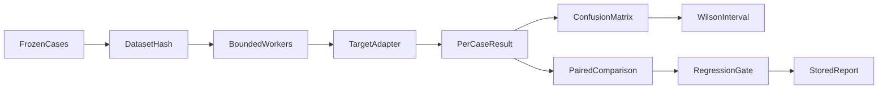

# Architecture and extension points

## Data flow

## Module boundaries

`app/main.py` owns Pydantic contracts and HTTP behavior. The domain module owns scoring, retrieval, authorization, evaluation or privacy state. `app/platform.py` owns bounded HTTP bodies, local trust checks, metadata audit persistence and frontend mounting. The React workbench is a client of the same public API documented by FastAPI.

SQLite transactions use parameterized queries and close their connections at scope exit. WAL is selected for local read/write concurrency. Domain state and audit records are separate concerns: the audit append is not generally atomic with a domain state change. Deploy one process for Privacy Relay's in-memory vault.

## Decisions

| Decision | Reason | Tradeoff |
| --- | --- | --- |
| Small independent repository | Easy to clone, review, run and extend | Common workbench infrastructure is duplicated |
| FastAPI + React | Typed request validation and familiar full-stack interfaces | Shared types are not code-generated yet |
| SQLite | Zero external service and deterministic fixtures | Not a high-throughput multi-tenant design |
| Offline default | Reproducible demos without credentials or paid inference | Does not prove behavior of a live model |
| Inspectable algorithms | Failures can be explained during review | Baselines have documented recall/precision limits |

## Extension plan

1. 引入按模板家族分组的独立测试集，控制数据泄漏，并扩展到多轮与跨语言攻击。
2. 增加独立的真实模型 canary 泄露评测任务，使用不同 grader 与任务标识，禁止与检测指标混比。
3. 接入可授权的开放数据集，记录许可证、版本与污染检查；添加 paired bootstrap 和成本预算。

Before implementing an extension, define its acceptance metric, failure budget and comparison baseline. Keep transport errors separate from successful defenses and keep external validation data separate from development fixtures.
